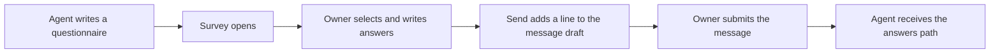

# Cockpit Survey

[Русский](README.ru.md)

## Purpose and requirements

Cockpit Survey is a standalone survey panel for Claude Code. An agent writes
a questionnaire in the project; the owner selects options, reads explanations
and enters free-text answers in the panel. Only the `survey` mod is included.

Requires Linux or macOS, Python 3.10+ and Claude Code with the mods API.
The installer checks CLI support, validates the mod and runs the bundled
file helper against an empty temporary directory. The source API baseline is
2.1.289; the oldest compatible release has not been established.
Git, a task database and executor tools are not required. Nerd Font is optional.

## Install

Keep this distribution in a permanent directory and run:

```sh
sh install.sh
```

The installer registers the local marketplace `cockpit-survey` and installs
only `survey` for the current user. It preserves other plugins and settings.
It does not install packages, create a runtime link or create survey files.
Restart Claude Code after installation. Keep this directory in place because
the local marketplace uses its path. Running the installer again skips completed
steps and enables the mod if it was disabled. A foreign marketplace with the
same name is left untouched.

## First survey

Ask the agent to prepare a questionnaire using the bundled `survey-authoring`
skill and write `.cockpit/surveys/<id>.json`. Successful Write/Edit calls open
the panel automatically. Session start restores the latest unfinished survey;
if the mod was loaded later and missed the write, the next user prompt checks
for an unfinished survey. `/survey` opens it manually. If the host cannot place
the panel, a button above the prompt offers to open it.

Choose options by clicking their labels. Hovering a label reveals its details;
descriptions and question text do not highlight on their own. Click a question
to expand or collapse it. Text questions and “Other” open an input field.
Action captions appear when hovering their icons.

Commands:

- `/survey [id]` opens the latest survey or a specific id.
- `/survey list` lists available ids.
- `/survey answer <questionId> <text>` saves text in the active survey.
- `/survey open <id>` opens an id that is also a command name, such as `list`.

Each change saves `<id>.answers.json`. Send marks the answers complete, closes
the panel and appends `Анкета «<id>» заполнена.` to the existing input draft.
Review and submit that draft yourself. On submission, the agent receives the
answers path in hidden context; the path is not added to the visible message.
The mod does not submit the message automatically. Reset clears answers and
the pending delivery. Incomplete surveys warn on the first Send press and can
be sent as-is on the second press.

## Settings and data



If Python or the file helper is unavailable, the native AskUserQuestion tool
remains usable. Once the helper works again, questions use Survey.

Descriptions and defaults below come from the included mod's current schema.

| Setting | Default | Description from the mod |
| --- | --- | --- |
| `glyphs` | `"nerd"` | Значки FileTree: Nerd Font или обычный Unicode; auto выбирает Unicode вне терминала |

View settings or switch to ordinary Unicode icons:

```sh
claude plugin configure survey@cockpit-survey --json
printf '%s\n' '{"glyphs":"plain"}' | claude plugin configure survey@cockpit-survey --values-stdin
```

Restart Claude Code after changing settings. Definitions and answers remain in
the project's `.cockpit/surveys/` directory on the machine running Claude Code.
The mod does not upload them. Answers are delivered to the agent when you submit
the completion message. Symbolic links are rejected and writes are atomic.
The host must provide its filesystem/process APIs and Python POSIX facilities
`dir_fd` and `O_NOFOLLOW`; native remote hosts without these APIs cannot save.

If the panel is empty, ask the agent to create a survey, then use `/survey list`.
If saving fails, check Python and the distribution's `hooks/files.py`, then rerun
the installer. See the included [format and example](agents/claude/plugins/survey/skills/survey-authoring/SKILL.md).

## Update and uninstall

Close Claude Code and update this distribution in the same directory. Then run:

```sh
sh install.sh
claude plugin marketplace update cockpit-survey
claude plugin update survey@cockpit-survey --scope user
```

Restart Claude Code. Existing project surveys and answers remain in place.
To uninstall, close Claude Code and run:

```sh
claude plugin uninstall survey@cockpit-survey --scope user
claude plugin marketplace remove cockpit-survey
```

You can then remove this distribution. Project survey data remains; deleting
it is a separate owner decision.

## License

Distribution author: Roman Dmytriev. Copyright (c) 2026 Roman Dmytriev.

Licensed under [MIT](LICENSE). Original source licenses and
[third-party notices](THIRD_PARTY_NOTICES.md) are preserved.
