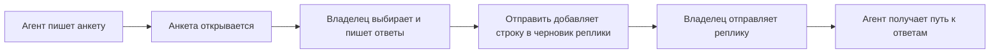

# Cockpit Survey

[English](README.md)

## Назначение и требования

Cockpit Survey — отдельная панель анкет для Claude Code. Агент пишет анкету
в проекте, владелец выбирает варианты, читает пояснения и вводит свободные
ответы в панели. В поставку входит только мод `survey`.

Нужны Linux или macOS, Python 3.10+ и Claude Code с API модов. Установщик
проверяет возможности CLI, контракт мода и файловый помощник на пустом
временном каталоге. Исходный API — 2.1.289; самая ранняя совместимая версия
не установлена. Git, база задач и инструменты исполнителей не нужны.
Nerd Font необязателен.

## Установка

Сохраните поставку в постоянном каталоге и выполните:

```sh
sh install.sh
```

Установщик зарегистрирует локальный каталог модов `cockpit-survey`
и установит только `survey` для текущего пользователя. Другие моды и настройки
сохраняются. Пакеты, ссылка на рантайм и файлы анкет при установке не создаются.
Перезапустите Claude Code. Сохраните каталог поставки на месте: локальный
каталог модов использует его путь. Повторный запуск пропускает выполненные
шаги и включает отключённый мод. Чужой одноимённый каталог модов не заменяется.

## Первая анкета

Попросите агента составить анкету по встроенному скиллу `survey-authoring`
и записать `.cockpit/surveys/<id>.json`. Успешные Write/Edit открывают панель
автоматически. При старте сессии восстанавливается последняя незавершённая
анкета; если мод загрузился позже и пропустил запись, следующий запрос
владельца проверит каталог. `/survey` открывает её вручную. Если хост не смог
разместить панель, над вводом появится кнопка открытия.

Нажимайте на метки вариантов. Наведение на метку раскрывает её пояснение;
строки описания и текст вопроса самостоятельно не подсвечиваются. Нажатие
на вопрос раскрывает или сворачивает его. Текстовый вопрос и «Свой вариант»
открывают поле ввода. Подпись действия появляется при наведении на его значок.

Команды:

- `/survey [id]` — открыть последнюю анкету или указанную по id.
- `/survey list` — показать доступные id.
- `/survey answer <questionId> <текст>` — сохранить текст в активной анкете.
- `/survey open <id>` — открыть id, совпавший с командой, например `list`.

Каждое изменение сохраняется в `<id>.answers.json`. «Отправить» отмечает
ответы завершёнными, закрывает панель и дописывает в существующий черновик
`Анкета «<id>» заполнена.` Проверьте и отправьте этот черновик сами. При его
отправке агент получает путь к ответам скрытым контекстом; в видимом сообщении
пути нет. Мод сам сообщение не отправляет. «Сбросить» очищает ответы и ожидающую
передачу. Если есть пропуски, первое нажатие «Отправить» предупреждает,
второе отправляет анкету как есть.

## Настройки и данные



При недоступном Python или файловом помощнике штатный AskUserQuestion остаётся
доступен. После восстановления помощника вопросы снова направляются в Survey.

Описания и значения по умолчанию берутся из текущего контракта вложенного мода.

| Настройка | По умолчанию | Описание из мода |
| --- | --- | --- |
| `glyphs` | `"nerd"` | Значки FileTree: Nerd Font или обычный Unicode; auto выбирает Unicode вне терминала |

Просмотр настроек и переход на обычные Unicode-значки:

```sh
claude plugin configure survey@cockpit-survey --json
printf '%s\n' '{"glyphs":"plain"}' | claude plugin configure survey@cockpit-survey --values-stdin
```

После изменения настроек перезапустите Claude Code. Определения анкет и ответы
лежат в `.cockpit/surveys/` проекта на машине, где работает Claude Code.
Мод не выгружает их на сервер. Агент получает ответы после отправки сообщения
о заполнении. Симлинки запрещены; запись атомарная. Хост должен предоставлять
API файлов и процессов, а Python — POSIX-средства `dir_fd` и `O_NOFOLLOW`.
На нативном удалённом хосте без этих API сохранение недоступно.

Если панель пуста, попросите агента создать анкету и выполните `/survey list`.
Если сохранение не работает, проверьте Python и `hooks/files.py` поставки,
затем повторите установку. [Формат и пример](agents/claude/plugins/survey/skills/survey-authoring/SKILL.md)
входят в поставку.

## Обновление и удаление

Закройте Claude Code и обновите файлы поставки в том же каталоге. Затем выполните:

```sh
sh install.sh
claude plugin marketplace update cockpit-survey
claude plugin update survey@cockpit-survey --scope user
```

Перезапустите Claude Code. Анкеты и ответы в проектах сохраняются.
Для удаления закройте Claude Code и выполните:

```sh
claude plugin uninstall survey@cockpit-survey --scope user
claude plugin marketplace remove cockpit-survey
```

После этого можно удалить каталог поставки. Данные анкет в проектах остаются;
их удаление — отдельное решение владельца.

## Лицензия

Автор поставки: Roman Dmytriev. Copyright (c) 2026 Roman Dmytriev.

Лицензия — [MIT](LICENSE). Исходные лицензии и
[уведомления о стороннем коде](THIRD_PARTY_NOTICES.md) сохранены.
